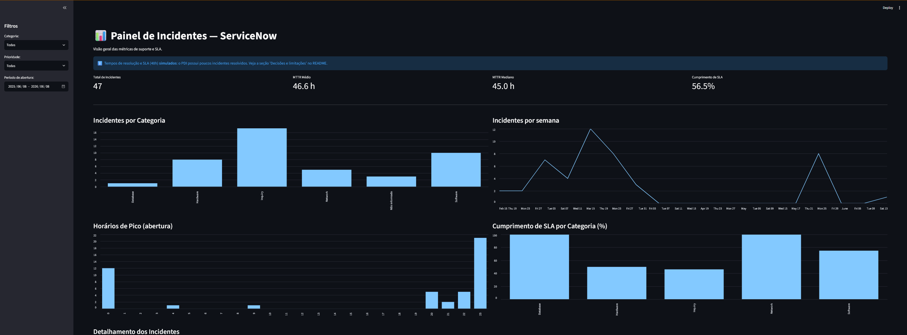

# 📊 Painel de Incidentes — ServiceNow

Dashboard interativo em Python para análise de chamados de TI, alimentado pela API REST (Table API) do ServiceNow. Projeto pessoal inspirado na rotina de suporte N2 em ambiente corporativo.

## 🖼️ Visão geral



> Captura com dados **sintéticos** (modo `--sintetico`): por isso o aviso azul no topo.

## 🚀 Funcionalidades
- Coleta de incidentes via API REST do ServiceNow, com paginação e timeout.
- Tratamento dos dados (datas, categorias vazias, prioridades).
- Métricas: total de incidentes, **MTTR** e **cumprimento de SLA**.
- Gráficos: incidentes por categoria, evolução diária, **horários de pico** e **SLA por categoria**.
- Filtros por categoria, prioridade e período.
- Interface interativa com Streamlit.

## 🛠️ Tecnologias
Python 3 · Streamlit · Pandas · NumPy · Requests

## ⚙️ Como rodar

### Opção 1 — Só ver o painel (sem credenciais)
O repositório já inclui `dados_incidentes.csv`.
```bash
python -m venv .venv
.venv\Scripts\Activate.ps1      # Windows (Linux/macOS: source .venv/bin/activate)
pip install -r requirements.txt
streamlit run app.py
```

### Opção 2 — Gerar dados da sua própria instância
Defina as variáveis de ambiente (use um PDI, nunca uma instância de produção):
```powershell
$env:SN_URL  = "https://devXXXXX.service-now.com"
$env:SN_USER = "seu_usuario"
$env:SN_PASS = "sua_senha"
```
Depois escolha o modo:
```bash
python gerar_dados.py              # tempos reais (resolved_at - opened_at)
python gerar_dados.py --sintetico  # tempos simulados + SLA fixo de 48h
```

## 🧭 Decisões e limitações
- **Dados sintéticos:** o PDI tem poucos incidentes resolvidos, então o modo `--sintetico` gera tempos de resolução aleatórios (seed fixa, ~20% de casos lentos) e define um SLA fixo de 48h. Nesse modo, **MTTR e SLA não representam dados reais**; o painel exibe um aviso quando isso acontece. No modo padrão, o tempo é calculado de `opened_at` e `resolved_at` e o prazo vem do campo `sla_due`.
- **SLA:** em produção, prazos variam por prioridade e vêm da tabela `task_sla`. Este projeto usa o campo `sla_due` do incidente ou o valor fixo do modo sintético.
- **Fuso horário:** o ServiceNow retorna datas em UTC; os horários de pico não são convertidos para o fuso local.
- **Volume:** a coleta é limitada a 5.000 incidentes (`LIMITE_MAXIMO`).
- **SSL:** a verificação de certificado fica ligada por padrão. `SN_VERIFY_SSL=false` existe só para ambientes de teste.
- **Credenciais:** nunca versione senhas; use variáveis de ambiente. O `.gitignore` já ignora `.env`.

## 🔭 Próximos passos
- Prazo de SLA por prioridade via tabela `task_sla`.
- Deploy no Streamlit Community Cloud.
- Testes automatizados para o tratamento de dados.